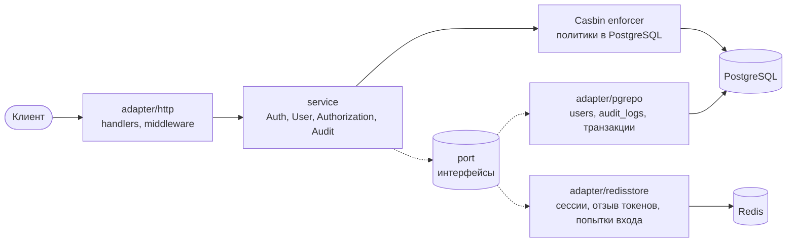
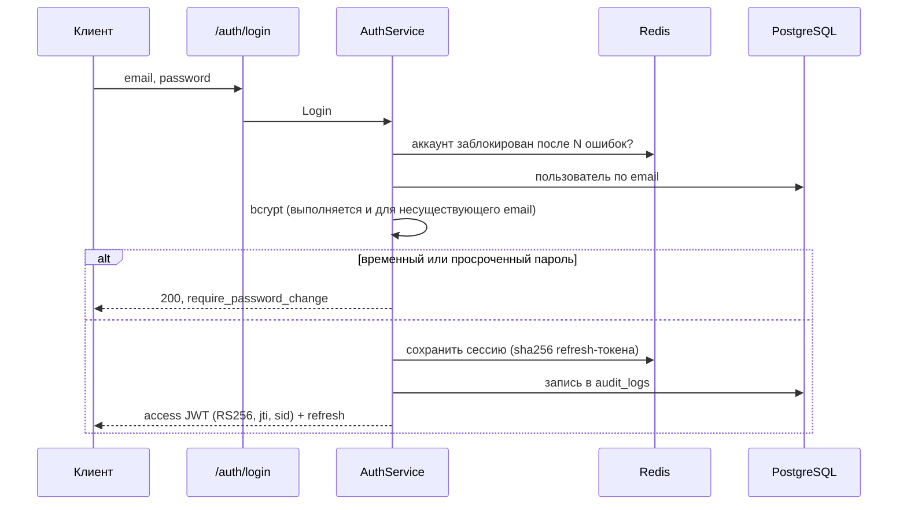

# iam-service

[](https://github.com/andrewhigh08/iam-service/actions/workflows/ci.yml)
[](go.mod)
[](LICENSE)

Сервис аутентификации и управления доступом (Identity and Access Management) на Go.
Выдаёт и проверяет JWT, хранит сессии, применяет ролевую модель доступа и ведёт журнал аудита.
Рассчитан на роль «центрального IAM» для группы внутренних сервисов: они проверяют access-токены
локально по публичному ключу из JWKS, а всё, что связано с паролями, сессиями и ролями, остаётся здесь.

## Что умеет

**Аутентификация**
- JWT access-токены с подписью RS256, публичный ключ отдаётся по `/.well-known/jwks.json`.
- Refresh-токены с ротацией: каждый `/auth/refresh` атомарно забирает старый токен и выдаёт новую пару.
  Повторное предъявление уже использованного токена считается кражей: все сессии пользователя отзываются.
  В Redis хранится только SHA-256 токена. Сессия живёт не дольше `JWT_SESSION_MAX_AGE`, сколько бы её ни обновляли.
- Отзыв: чёрный список по `jti` при logout и отзыве сессии, отметка «все токены до момента T недействительны» при
  logout со всех устройств, смене пароля и блокировке пользователя.
- Временные пароли при создании пользователя и срок жизни пароля с принудительной сменой.
- Защита от перебора: лимит попыток входа на IP и временная блокировка аккаунта после N ошибок;
  неверный текущий пароль при смене пароля считается так же, как неудачный вход.
  Ответы на неверный email и неверный пароль неразличимы, в том числе по времени (bcrypt выполняется всегда).
- Список активных сессий и отзыв любой из них.

**Авторизация**
- RBAC на Casbin: роли `admin`, `analyst`, `viewer`, политики хранятся в PostgreSQL.
- Проверка прав в middleware по паре «ресурс, действие».
- Опциональная синхронизация политик между репликами через Redis (casbin redis-watcher).

**Управление пользователями и аудит**
- Создание, просмотр, список с фильтрами и пагинацией, блокировка и разблокировка.
- Журнал аудита для всех событий безопасности, с IP и User-Agent, и чтение журнала по пользователю через API.
  Действия: `auth.login.success`, `auth.login.failed`, `auth.login.locked`, `auth.logout`, `auth.logout_all`,
  `auth.token.refresh`, `auth.token.reuse`, `auth.password.change`, `auth.session.revoke`, `user.create`,
  `user.block`, `user.unblock`.

**Эксплуатация**
- Конфигурация через переменные окружения с валидацией при старте.
- Миграции схемы встроены в бинарник и применяются при запуске.
- Метрики Prometheus, трассировка OpenTelemetry (HTTP, PostgreSQL, Redis), структурированные логи с
  `request_id` и `trace_id`, liveness/readiness-пробы, graceful shutdown.
- Docker-образ без root, `docker compose` со всем стеком наблюдаемости, готовый дашборд Grafana.

## Быстрый старт

Нужны Docker и Docker Compose v2. Для работы вне compose: PostgreSQL 14+ и Redis 7+ (используются команды `EXPIRE ... NX|GT`).

```bash
git clone https://github.com/andrewhigh08/iam-service.git
cd iam-service
make up            # API, PostgreSQL, Redis, Prometheus, Grafana, Jaeger
```

Вход под администратором (учётная запись создаётся при первом запуске, см. `ADMIN_EMAIL` и `ADMIN_PASSWORD`):

```bash
curl -s http://localhost:8080/auth/login \
  -H 'Content-Type: application/json' \
  -d '{"email":"admin@example.com","password":"Admin123!"}'
```

```json
{
  "success": true,
  "data": {
    "access_token": "eyJhbGciOiJSUzI1NiIs...",
    "refresh_token": "3f9c1a...",
    "token_type": "Bearer",
    "expires_in": 900,
    "user": { "id": 1, "email": "admin@example.com", "roles": ["admin"] }
  }
}
```

| Что | Где |
|-----|-----|
| Swagger UI | http://localhost:8080/swagger/index.html |
| JWKS | http://localhost:8080/.well-known/jwks.json |
| Prometheus | http://localhost:9090 |
| Grafana (admin / admin) | http://localhost:3000, дашборд «IAM Service» |
| Jaeger | http://localhost:16686 |

Локальный запуск без контейнера для приложения: поднять зависимости `docker compose up -d postgres redis`,
скопировать `.env.example` в `.env` и выполнить `make run`.

## Архитектура

Проект построен по принципу «порты и адаптеры»: бизнес-логика в `internal/service` зависит только от
интерфейсов из `internal/port` и доменных типов из `internal/domain`. Реализации интерфейсов живут в
`internal/adapter`, а сборка зависимостей и HTTP-роутер в `internal/app`. Направление зависимостей
проверяется тестом: пакет `service` не может импортировать ничего из `adapter`.



Транзакции пересекают границу слоёв через `port.TxManager`: сервис вызывает `WithinTx(ctx, fn)`,
а репозитории достают транзакцию из `context.Context`. Сервисы не знают о GORM.

Поток входа:



Структура репозитория:

```
cmd/api/              точка входа
internal/app/         сборка зависимостей, роутер, запуск и остановка
internal/domain/      сущности и доменные константы
internal/port/        интерфейсы между слоями
internal/service/     бизнес-логика
internal/adapter/     http, postgres, redis
internal/config/      конфигурация
internal/pkg/         apperror, logger, metrics, telemetry, validator
migrations/           SQL-миграции (golang-migrate, встроены через embed)
test/integration/     тесты на реальных PostgreSQL и Redis (testcontainers)
docs/                 swagger (генерируется), ADR
```

Ключевые решения описаны в [docs/adr](docs/adr).

## API

Все ответы в едином конверте `{"success": bool, "data": ..., "error": {"code", "message", "details"}, "meta": ...}`.

| Метод | Путь | Доступ | Описание |
|-------|------|--------|----------|
| `POST` | `/auth/login` | публичный | Вход, выдаёт пару токенов или требование сменить пароль |
| `POST` | `/auth/refresh` | публичный | Обновление пары токенов с ротацией refresh-токена |
| `POST` | `/auth/logout` | публичный | Отзыв refresh-токена и access-токена из заголовка |
| `POST` | `/auth/change-password` | публичный | Смена временного или просроченного пароля |
| `GET` | `/.well-known/jwks.json` | публичный | Публичные ключи для проверки подписи |
| `POST` | `/api/v1/change-password` | JWT | Смена пароля, отзывает остальные сессии |
| `POST` | `/api/v1/logout-all` | JWT | Выход со всех устройств |
| `GET` | `/api/v1/sessions` | JWT | Активные сессии текущего пользователя |
| `DELETE` | `/api/v1/sessions/:id` | JWT | Отзыв сессии |
| `GET` | `/api/v1/users` | `users:read` | Список с фильтрами `status`, `search` и пагинацией |
| `GET` | `/api/v1/users/:id` | `users:read` | Пользователь по id |
| `GET` | `/api/v1/users/:id/audit` | `audit:read` | Последние записи аудита о действиях пользователя (`limit`, до 100) |
| `POST` | `/api/v1/users` | `users:write` | Создание пользователя с ролью, можно с временным паролем |
| `POST` | `/api/v1/users/:id/block` | `users:write` | Блокировка: отзывает все сессии и токены; повторный вызов повторяет отзыв |
| `POST` | `/api/v1/users/:id/unblock` | `users:write` | Разблокировка |
| `GET` | `/health/live`, `/health/ready` | публичный | Пробы для Kubernetes |
| `GET` | `/metrics` | публичный | Метрики Prometheus |
| `GET` | `/swagger/*` | публичный | Swagger UI |

Полное описание с примерами запросов и ответов: Swagger UI или [docs/swagger.yaml](docs/swagger.yaml).
Служебные эндпоинты (`/metrics`, `/swagger`, `/health/*`) открыты без аутентификации; в production их принято закрывать на уровне ingress или сетевых политик.

Роли и права:

| Роль | users:read | users:write | audit:read |
|------|:---:|:---:|:---:|
| admin | да | да | да |
| analyst | да | | да |
| viewer | да | | |

## Безопасность: принятые решения

- **RS256 вместо HS256.** Приватный ключ есть только у IAM, остальные сервисы проверяют токены по JWKS.
  При проверке допускается только алгоритм RS256, обязательны `exp`, `iat` и `iss`.
- **Короткие access-токены (15 минут по умолчанию) и отзыв.** Logout заносит `jti` в чёрный список
  до истечения токена. Logout со всех устройств, смена пароля и блокировка ставят отметку
  «токены, выданные до T, недействительны». Проверка этих отметок делается на каждом запросе.
- **Fail closed.** Если Redis недоступен, защищённые запросы получают 503, а не проходят без проверки
  отзыва; проверка пароля при входе и смене пароля тоже отвечает 503, а не работает без учёта попыток.
  Для IAM доступность не важнее корректности. Redis должен работать без вытеснения ключей
  (`maxmemory-policy noeviction`), иначе отметки об отзыве могут быть потеряны; сервис проверяет это при старте
  и пишет ошибку в лог.
- **Refresh-токены хранятся только в виде хеша**, ротируются при каждом обновлении, привязаны к сессии
  с IP и User-Agent. Отзыв сессии и ротация заносят в чёрный список и access-токен этой сессии.
- **Ключи RSA не короче 2048 бит**; при проверке токенов допускается расхождение часов реплик до 30 секунд,
  реплики должны синхронизировать время (NTP).
- **Единый ответ на неверные учётные данные** и bcrypt для несуществующих пользователей, чтобы не
  раскрывать существование аккаунта ни текстом, ни временем ответа.
- **Блокировка аккаунта** после `LOCKOUT_MAX_ATTEMPTS` ошибок на `LOCKOUT_DURATION`, плюс отдельный
  лимит на IP для `/auth/login` и `/auth/change-password`.
- **Политика паролей** применяется в сервисном слое для всех способов установки пароля, включая `ADMIN_PASSWORD`:
  от 8 до 128 символов и не более 72 байт в UTF-8 (предел bcrypt), строчные и заглавные буквы, цифры,
  спецсимволы, запрет распространённых паролей.
- **Заголовки безопасности** на всех ответах, `Cache-Control: no-store` для `/auth` и `/api`,
  ограничение размера тела запроса, настраиваемый список доверенных прокси для корректного определения IP.
- **Секреты не попадают в логи**: пароли, токены и хеши никогда не логируются.

## Конфигурация

Переменные окружения, файл `.env` в рабочей директории читается, но не перекрывает уже заданные переменные.

| Переменная | По умолчанию | Описание |
|------------|--------------|----------|
| `SERVER_PORT` | `8080` | Порт HTTP |
| `SERVER_READ_TIMEOUT` / `SERVER_WRITE_TIMEOUT` | `15s` | Таймауты HTTP-сервера |
| `SERVER_SHUTDOWN_TIMEOUT` | `10s` | Время на завершение запросов при остановке |
| `LOG_LEVEL`, `LOG_FORMAT` | `info`, `json` | Логи (`json` или `text`) |
| `DB_HOST`, `DB_PORT`, `DB_USER`, `DB_PASSWORD`, `DB_NAME`, `DB_SSLMODE` | `localhost`, `5432`, `iam_user`, `iam_password`, `iam_db`, `disable` | PostgreSQL |
| `DB_MAX_OPEN_CONNS`, `DB_MAX_IDLE_CONNS` | `25`, `5` | Пул соединений; `DB_MAX_OPEN_CONNS` равен 0 (без лимита) или не меньше 2 |
| `DB_MIGRATE` | `true` | Применять миграции при старте |
| `REDIS_HOST`, `REDIS_PORT`, `REDIS_PASSWORD`, `REDIS_DB` | `localhost`, `6379`, пусто, `0` | Redis |
| `JWT_PRIVATE_KEY_PATH`, `JWT_PUBLIC_KEY_PATH` | `configs/keys/private.pem`, `configs/keys/public.pem` | RSA-ключи в PEM |
| `JWT_ACCESS_TOKEN_TTL` | `15m` | Время жизни access-токена |
| `JWT_REFRESH_TOKEN_TTL` | `168h` | Время жизни refresh-токена и сессии |
| `JWT_SESSION_MAX_AGE` | `720h` | Предельный возраст сессии при любом числе обновлений, `0` отключает |
| `JWT_ISSUER` | `iam-service` | Значение `iss` |
| `DEV_MODE` | `false` | В режиме разработки ключи генерируются при отсутствии, а пароль администратора может быть пустым |
| `ADMIN_EMAIL`, `ADMIN_PASSWORD` | `admin@example.com`, пусто | Первый администратор; существующему аккаунту с этим email выдаётся роль `admin`. Вне `DEV_MODE` пароль обязателен и проверяется политикой паролей; пустой `ADMIN_EMAIL` отключает создание |
| `CASBIN_MODEL_PATH` | `configs/casbin_model.conf` | Модель Casbin |
| `AUTHZ_WATCHER_ENABLED` | `false` | Синхронизация политик между репликами через Redis |
| `LOCKOUT_MAX_ATTEMPTS`, `LOCKOUT_DURATION` | `5`, `15m` | Блокировка аккаунта после неудачных попыток |
| `PASSWORD_MAX_AGE` | `2160h` | Срок жизни пароля, `0` отключает |
| `RATE_LIMIT_RPS`, `RATE_LIMIT_BURST` | `100`, `200` | Общий лимит на IP |
| `LOGIN_RATE_LIMIT_PER_MIN`, `LOGIN_RATE_LIMIT_BURST` | `5`, `10` | Лимит на IP для входа и смены пароля |
| `CORS_ALLOWED_ORIGINS` | пусто | Список origin через запятую (со схемой, не более одного `*` в записи); пусто отключает CORS |
| `TRUSTED_PROXIES` | пусто | Прокси, чьим `X-Forwarded-For` можно верить |
| `OTEL_ENABLED`, `OTEL_ENDPOINT`, `OTEL_SERVICE_NAME`, `OTEL_ENVIRONMENT` | `false`, `localhost:4317`, `iam-service`, `development` | Трассировка (OTLP gRPC) |

Для production: `DEV_MODE=false`, заранее сгенерированные ключи (`openssl genpkey -algorithm RSA -pkeyopt rsa_keygen_bits:2048`),
задать `ADMIN_PASSWORD` и `TRUSTED_PROXIES`. Все значения проверяются при старте: каждое сообщение об ошибке называет переменную.

## Разработка

```bash
make help              # список команд
make run               # запуск локально
make test              # юнит-тесты с -race и покрытием
make test-integration  # интеграционные тесты, нужен Docker
make lint              # golangci-lint v2
make generate          # перегенерировать моки и swagger после правки интерфейсов или обработчиков
make build             # статический бинарник в bin/
```

Нужны Go 1.26 и Docker для интеграционных тестов. golangci-lint, моки и swagger запускаются через `go run`,
отдельно ставить ничего не требуется. Правила для контрибьюторов и ИИ-агентов собраны в [AGENTS.md](AGENTS.md).

## Тестирование

- **Юнит-тесты** (`make test`): сервисы на gomock-моках портов, Casbin с политиками в памяти, middleware,
  обработчики, конфигурация, валидатор. Запускаются с `-race`.
- **Интеграционные тесты** (`make test-integration`): поднимают PostgreSQL 17 и Redis 8 через testcontainers,
  собирают приложение целиком и проходят пользовательские сценарии по HTTP: вход администратора, создание
  пользователя с временным паролем и его смена, проверка RBAC, ротация refresh-токена, logout со всех устройств,
  повторное использование refresh-токена, блокировка с немедленным отзывом токенов, блокировка аккаунта
  после неудачных попыток входа и смены пароля, записи аудита и их чтение по API, применение миграций вверх и вниз.

CI (GitHub Actions) гоняет `go mod tidy -diff`, проверку свежести сгенерированного кода, golangci-lint,
юнит- и интеграционные тесты, gosec и govulncheck, сборку образа и сканирование Trivy. Образ публикуется в
GitHub Container Registry при пуше в `main` и по тегам `v*`.

## Наблюдаемость

- **Метрики** на `/metrics`: `iam_http_requests_total{method,path,status}`, `iam_http_request_duration_seconds`,
  `iam_http_requests_in_flight`, `iam_auth_attempts_total{result}`, `iam_authz_decisions_total{result,resource,action}`.
  Метка `path` содержит шаблон маршрута, а не конкретный URL.
- **Трассировка**: при `OTEL_ENABLED=true` спаны создаются для HTTP-запросов, запросов к PostgreSQL и Redis
  и отправляются по OTLP (в compose-стеке в Jaeger).
- **Логи**: JSON через `log/slog`, в каждой записи `request_id`, при наличии `user_id`, `trace_id` и `span_id`.
- **Grafana**: дашборд «IAM Service» подключается автоматически из `configs/grafana`.

## Чего нет и что можно добавить

- Нет эндпоинтов изменения и удаления пользователей и назначения ролей после создания.
- Нет восстановления пароля по email, MFA и внешних провайдеров (OAuth2/OIDC).
- Лимит запросов считается в памяти каждого экземпляра. При нескольких репликах лимит лучше держать на шлюзе.
- Политики Casbin загружаются при старте; синхронизация между репликами включается отдельно (`AUTHZ_WATCHER_ENABLED`).

## Лицензия

[MIT](LICENSE)
